I build responsive, animated interfaces with React and Next.js, and the REST APIs behind them with NestJS, Node.js and PostgreSQL. I'm a Computer Science student at Misr Higher Institute (Mansoura) and a Programming Instructor at 3C. Based in Tanta, Egypt.

### Frontend

 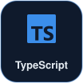  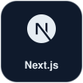 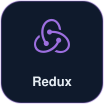 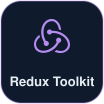 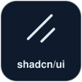 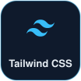 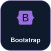 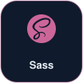 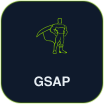

### Backend

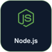 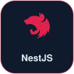 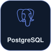 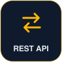 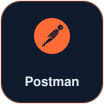

**Also familiar with:** Python, C++, C#, SQL Server, MySQL, Git, GitHub, Vite, Vercel

### Projects

| Project | Stack |
|---|---|
| **Animated Gaming Landing Page**: scroll-driven GSAP animations and video | React, Tailwind CSS, GSAP |
| **VS Code Clone**: sidebar, file tree, tabs and status bar | React, Tailwind CSS |
| **Milano Restaurant**: responsive, mobile-first website | HTML, CSS, JavaScript |
| **Database Management System**: relational data app | C#, SQL Server |

<!-- Add links like: [Live](https://...) · [Code](https://github.com/MohamedFetohRagab/...) -->

### Contact

 
